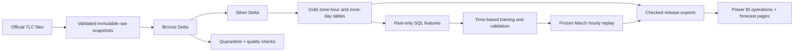
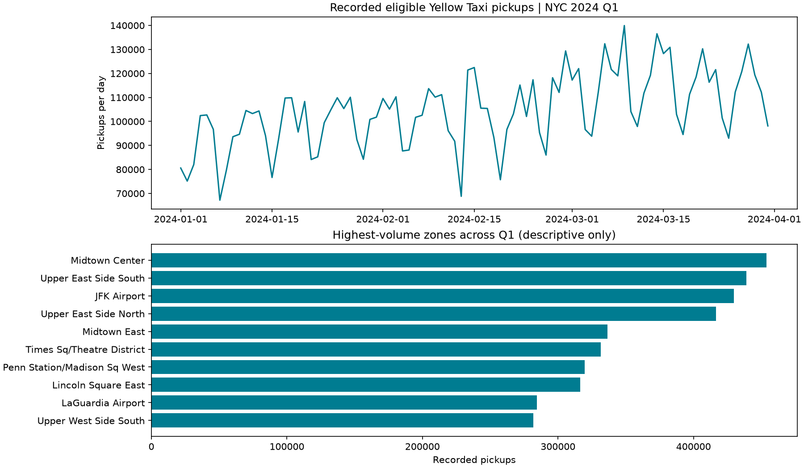

# NYC Taxi Lakehouse & Hourly Forecasting

A reproducible local data platform that turns **9.55 million NYC Yellow Taxi trips** into
quality-checked Delta tables, business aggregates, and next-hour pickup forecasts.
Python and SQL drive the pipeline; Spark handles trip-level processing; scikit-learn
models bounded hourly aggregates; Power BI presents operations and forecast evaluation.

**Scope:** January–March 2024, local Spark, offline one-hour historical replay.
This is a portfolio project, not a live dispatch service or a distributed benchmark.

## Results at a glance

| Measure | Recorded result |
|---|---:|
| Raw records | 9,554,778 |
| Eligible pickups | 9,517,009 |
| Quarantined records | 37,769 |
| March evaluation rows | 7,430 zone-hours |
| Weekly baseline MAE | 31.35 pickups / zone-hour |
| Model MAE | 25.21 pickups / zone-hour |
| Relative MAE improvement | 19.6% |
| Model WAPE | 14.3% |

These are results from the **2026-10-25 reference run**, not a claim that every future
run is identical. Full-volume ETL was rerun and exactly reconciled; nine original tests
passed. See [reference evidence](reports/reference/README.md) and
[acceptance status](docs/acceptance.md). Model selection uses February only; March is held out.


## How it works



The pipeline preserves source-row multiplicity, uses partition replacement for reruns,
and publishes only after quality and checksum checks. A dense UTC calendar keeps
New York daylight-saving transitions explicit. Details: [architecture](docs/architecture.md).

## Quick start

Clone this repository or download and extract its ZIP, then open the project folder.
Use **Python 3.11 and Java 17**. Run commands from this repository's root in an ordinary
terminal. The validated machine used Windows, 32 GB RAM, `local[4]`, a 6 GB Spark driver,
and 16 shuffle partitions. Reserve several GB of disk space beyond the 160.4 MB download.

```sh
python -m venv .venv
```

Activate the environment using the command for your shell:

| Shell | Command |
|---|---|
| Windows Command Prompt | `.venv\Scripts\activate.bat` |
| Windows PowerShell | `.venv\Scripts\Activate.ps1` |
| Linux / macOS shell | `source .venv/bin/activate` |

If PowerShell blocks scripts, use `.venv\Scripts\python.exe` instead of `python` in
the commands below; changing execution policy is unnecessary. Ensure `JAVA_HOME`
points to a Java 17 installation and `java -version` reports 17.

```sh
python -m pip install -r requirements.txt
python -m pytest -q
python -m taxi_project doctor
python tools/download_data.py --output downloads
python -m taxi_project run --profile sample --source-dir downloads
python -m taxi_project run --profile full --source-dir downloads
```

**Stop if `doctor` fails.** Windows may require compatible Hadoop native libraries;
this repository does not bundle them. See [installation and troubleshooting](docs/setup.md)
for the tested prerequisite and platform limits. First Spark startup also needs network
access to resolve Delta JVM dependencies.

The sample profile validates a bounded pipeline without training or publishing scores.
The full profile writes `current_release.json`, pointing to the completed release.
No cloud account, API key, paid database, or Power BI login is needed for local processing.

## Explore the project

| Path | Purpose |
|---|---|
| [taxi_project/](taxi_project/) | CLI, ingestion, Delta processing, features, modeling, publication |
| [sql/](sql/) | Zone-hour/day aggregation and past-only feature queries |
| [config/](config/) | Fixed experiment settings and official source checksums |
| [tests/](tests/) | Data semantics, leakage, metric, release and ingestion checks |
| [tools/](tools/) | Verified downloads, full rerun comparison and Power BI generation |
| [dashboard/](dashboard/) | Instructions for generating an editable Power BI project |
| [reports/reference/](reports/reference/) | Small, checked-in evidence from the original full run |
| [docs/](docs/) | Architecture, setup, data dictionary, learning guide and demo |
| [.github/workflows/ci.yml](.github/workflows/ci.yml) | Unit tests and isolated Spark fixture on Ubuntu |

`downloads/`, `data/`, `runs/`, `releases/`, caches, logs, and generated Power BI files are
ignored by Git. They are rebuilt locally; the raw dataset is not embedded in this repository.
Run from a source checkout: this version does not distribute a standalone Python wheel.

## Tests and reproducibility

```sh
# Unit tests; Spark fixture is skipped by default.
python -m pytest -q
# Spark/Delta fixture, using isolated synthetic records.
python -m pytest -q --run-spark
# After a successful full run: compare a second ETL build to pinned original versions.
python tools/verify_full.py
```

The last command writes `reports/full-rerun.json` and leaves the published release pointer
unchanged. It does not retrain the model. For commands, checkpoint recovery and output
contracts, see [workflow](docs/workflow.md).

## Dashboard and documentation

After a full local run:

```sh
python tools/build_powerbi.py
python tools/polish_powerbi.py
```

Open `dashboard/Taxi.pbip` in Power BI Desktop, refresh, and save a PBIX after validation.
The generated project binds to your local completed release. It may overwrite manual
report edits, so save a copy before regenerating. See [dashboard instructions](dashboard/README.md).



- [Setup and troubleshooting](docs/setup.md)
- [Architecture and design decisions](docs/architecture.md)
- [Data dictionary](docs/data_dictionary.md)
- [Workflow and recovery](docs/workflow.md)
- [Learning guide](docs/learning_guide.md)
- [Three-minute demo](docs/demo.md)
- [Validation and known limits](docs/acceptance.md)
- [Contributing](CONTRIBUTING.md)
- [Publishing this repository](docs/github.md)

## Limitations and data attribution

Pickup counts represent recorded trips, not unmet demand. The model assumes prior-hour
counts would be available at each forecast boundary; TLC's monthly files are not a live
feed. Better historical accuracy does not prove revenue or waiting-time improvement.
Fresh Ubuntu dependency installation and all 12 tests passed in
[GitHub Actions](https://github.com/JoeHuang666/nyc-taxi-lakehouse/actions/runs/40685318583).
No full-data run on a fresh machine, multi-node execution, or end-to-end failure injection
has been validated. Spark temporary JAR cleanup warnings remain on the original Windows host.

Data: [NYC TLC Trip Record Data](https://www.nyc.gov/site/tlc/about/tlc-trip-record-data.page).
Exact source URLs and SHA-256 hashes are in [config/sources.json](config/sources.json).
Code and documentation use the [MIT License](LICENSE). Third-party data and dependencies
retain their own terms; see [licensing and attribution](docs/licensing.md).
