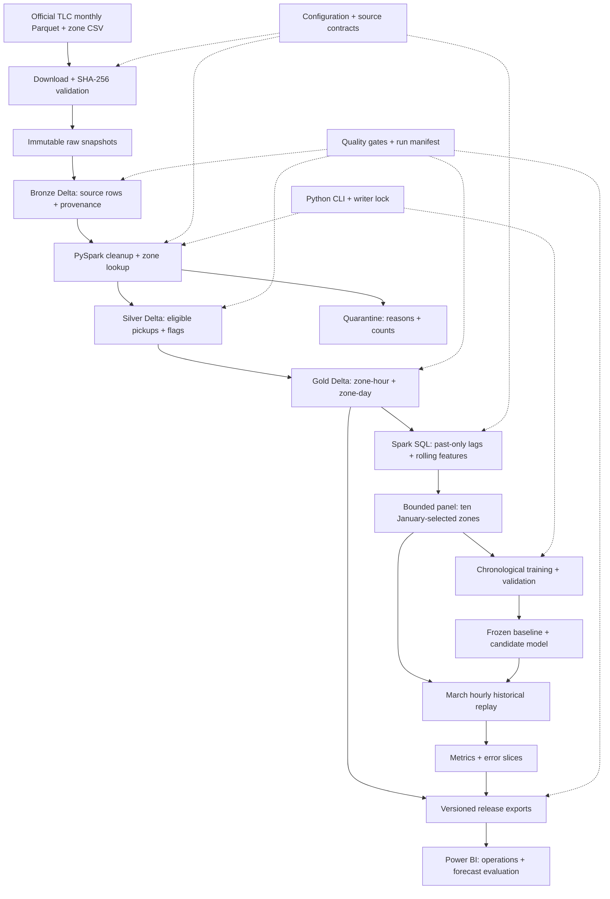

# Architecture and design

## Module responsibilities

| Module | Responsibility |
|---|---|
| `ingest.py` | Validate source contracts, preserve immutable SHA-256-addressed copies |
| `spark_session.py` | Local JVM configuration, Delta reads/writes and version pinning |
| `lakehouse.py` | Bronze/Silver/quarantine/Gold, zone lookup, UTC calendar and quality gates |
| `features.py` + `sql/features.sql` | Past-only feature construction and independent pandas oracle |
| `model.py` | Chronological selection, refit, frozen hourly replay and error metrics |
| `publish.py` | Checked CSV exports, charts, model card and release promotion |
| `common.py` | Configuration, hashes, manifests, writer lock and atomic pointer |
| `cli.py` | Stage order, failure recording and whole-build checkpoint reuse |

## Decisions that protect correctness

- Preserve duplicate source rows: no reliable trip ID exists. Monthly `replaceWhere`
  avoids accumulating a second copy when reprocessing a month.
- Eligibility depends on pickup time, source month and NYC zone. A negative fare does
  not erase a valid pickup; it is excluded from recorded-charge metrics.
- Create 2,183 consecutive UTC hour keys with New York local attributes. March 10 has
  23 local hours. Nonexistent local pickup timestamps are quarantined.
- Require all sources and city-hour coverage before treating empty zone-hours as zero.
- Select ten zones from January only. Train Jan 8–Feb 15, validate Feb 16–29, refit
  Jan 8–Feb 29, then evaluate March. No random train/test split.
- Lag/rolling windows end before the target. The baseline uses the previous local week;
  only a nonexistent previous local hour falls back to 168 elapsed hours.
- Train one pooled Poisson histogram gradient-boosting model with categorical one-hot
  zones, seed 42, disabled internal early stopping, and three parameter candidates.
- Bound model collections to 100,000 rows; stream full-city CSV exports from Spark.
- Pin table versions and publish one checked release atomically.

See [implementation decisions](decisions.md) and [data dictionary](data_dictionary.md).
Whole-build resume is supported; partial-month reuse and distributed orchestration are
outside this version. March replay assumes prior-hour actual counts are available,
which the public monthly dataset cannot provide in real time.
