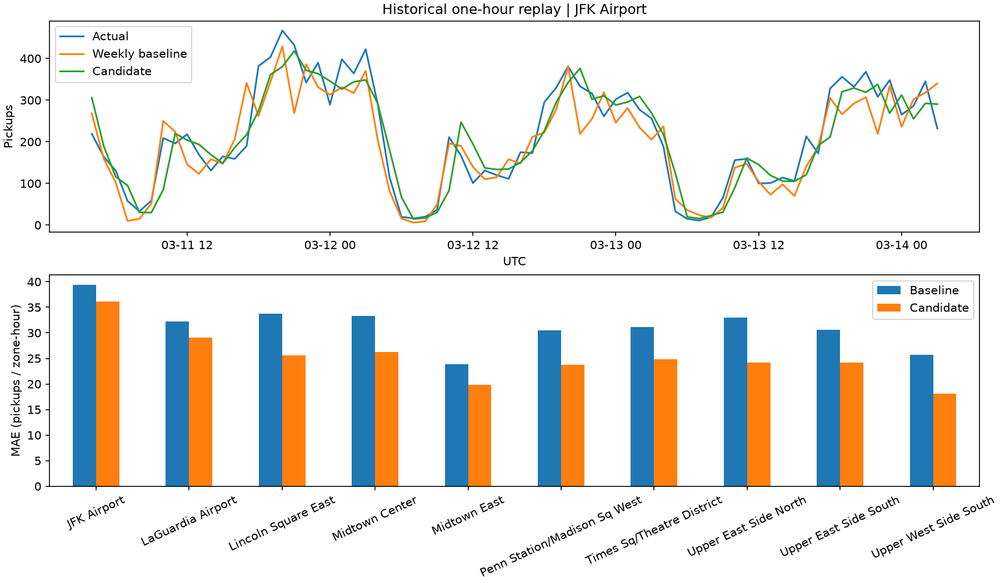

# Run report: 20261025T160102-15f12a

This is an offline historical one-hour replay, not a live prediction service.

- Raw rows: 9,554,778; eligible pickups: 9,517,009; quarantined: 37,769.
- Full Q1 calendar: 2,183 actual hours. March predictions: 7,430, coverage 100.0%.
- Weekly baseline MAE: 31.3502; candidate MAE: 25.2062.
- Weekly baseline WAPE: 17.79%; candidate WAPE: 14.31%.
- Relative candidate MAE improvement: 19.60%.
- Method selected using February validation only: candidate.
- Model ID: aa0faee5b6a04b0f.

## Interpretation
The model estimates eligible recorded pickups for ten zones selected using January.
A lower MAE may support staffing discussion; it does not establish additional revenue,
reduced waiting time, unmet demand, or the number of vehicles to dispatch.
The three largest model errors are in largest_errors.csv. Unobserved events, weather,
and traffic are possible omitted factors; no causal attribution was verified.

## Limitations
The prior hour is assumed fully available at each boundary. TLC monthly publication
does not meet this assumption. Original publication/revision histories are unavailable.
Zero-filled cells assume a successfully ingested complete monthly source.
This is local Spark on one machine; no distributed-load or cloud benchmark was performed.
Power BI visual acceptance is separate from the verified export metrics.
